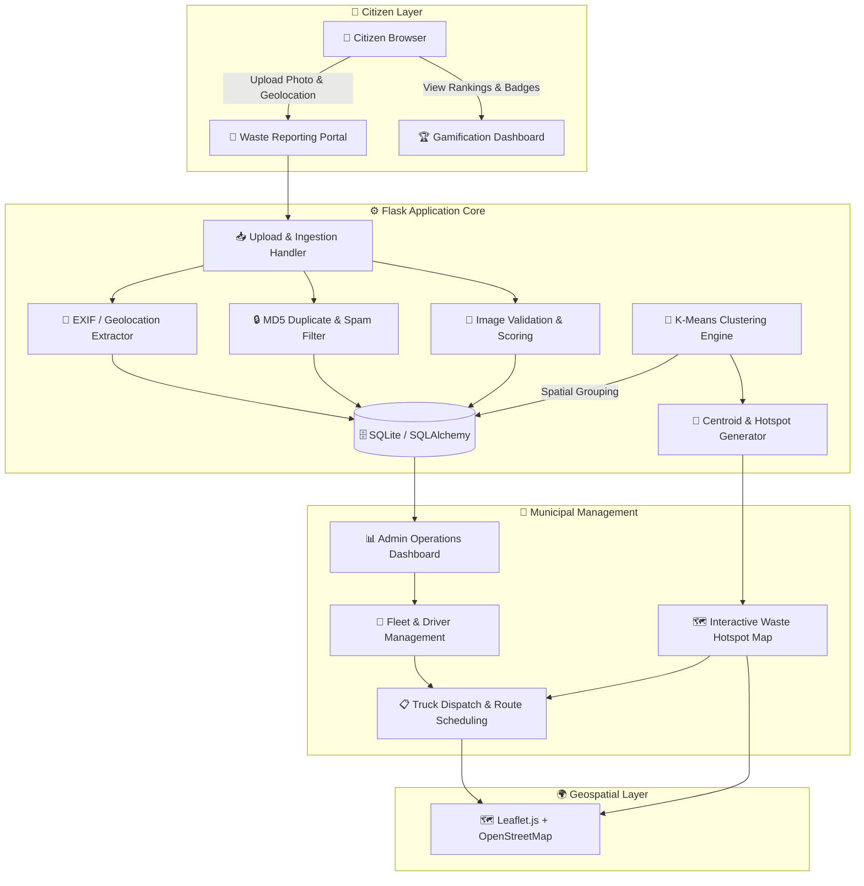

<p align="center">
  
</p>

<h1 align="center">♻️ CiviClean</h1>

<p align="center">
  <strong>AI-Powered Crowdsourced Waste Intelligence & Municipal Fleet Optimization Platform</strong>
</p>

<p align="center">
  <em>Transforming citizen waste reports into spatially-clustered, route-optimized collection plans for cleaner, smarter cities.</em>
</p>

<p align="center">
  <a href="https://civiclean.onrender.com/"></a>
</p>

<p align="center">
  
  
  
  
  
  
  
  
</p>

---

## 🌐 Live Demo & Access

> **🔗 Production URL:** **[https://civiclean.onrender.com](https://civiclean.onrender.com/)**

### 🔑 Demo Credentials

| Role | Login URL | Email | Password |
| :--- | :--- | :--- | :--- |
| **🛡️ Administrator** | [`/auth/login`](https://civiclean.onrender.com/auth/login) | `admin@civiclean.com` | `admin123` |
| **👤 Citizen** | [`/auth/register`](https://civiclean.onrender.com/auth/register) | *Self-register* | *User-defined* |

### 🗺️ Quick Navigation

| Page | URL | Description |
| :--- | :--- | :--- |
| 🏠 Homepage | [`/`](https://civiclean.onrender.com/) | Landing page with features overview |
| 📸 Report Waste | [`/upload`](https://civiclean.onrender.com/upload) | Submit geo-tagged waste photo reports |
| 🏆 Leaderboard | [`/leaderboard`](https://civiclean.onrender.com/leaderboard) | Community engagement rankings |
| 📊 Admin Dashboard | [`/admin/`](https://civiclean.onrender.com/admin/) | Operations command center |
| 🗺️ Waste Heatmap | [`/admin/map`](https://civiclean.onrender.com/admin/map) | Interactive hotspot visualization |
| 🚛 Fleet Dispatch | [`/admin/truck-assignments`](https://civiclean.onrender.com/admin/truck-assignments) | Truck scheduling & route management |

---

## 🎯 Problem Statement

Urban waste management in rapidly growing cities faces a critical operational gap:

<table>
<tr>
<td width="50%">

**❌ Current Challenges**
- Waste hotspots go **unreported** until they become health hazards
- Citizen complaints via calls/emails **lack GPS coordinates** and verified evidence
- Collection trucks follow **static, predefined routes** regardless of real-time accumulation
- Citizens receive **no feedback** on report resolution, leading to disengagement
- Municipalities **cannot prioritize** zones that need urgent attention

</td>
<td width="50%">

**✅ CiviClean's Solution**
- Citizens report waste with **geo-tagged photo evidence** in seconds
- Automatic **EXIF GPS extraction** + browser geolocation + interactive map picker
- **K-Means spatial clustering** dynamically groups reports into optimized collection zones
- **Gamification engine** (points, badges, leaderboards) keeps citizens engaged
- Admins get a **real-time command center** with fleet dispatch and route planning

</td>
</tr>
</table>

---

## 📸 Application Showcase

| Citizen Waste Reporting Interface | Report Confirmation & Gamification |
| :---: | :---: |
|  |  |
| *Citizens upload waste evidence with automatic GPS extraction and live Leaflet.js map preview* | *Submission receipt showing geocoded location, points earned, badge unlocks, and waste confidence score* |

<br>

| Municipal Fleet Dispatch & Route Planning |
| :---: |
|  |
| *Admin dashboard combining city-wide hotspot mapping, truck schedules, driver rosters, and daily dispatch assignments* |

---

## 🏗️ System Architecture



### 🔄 Operational Pipeline


```
📸 CAPTURE          📍 EXTRACT           🧠 CLUSTER          🚛 DISPATCH
─────────────  →   ──────────────  →    ──────────────  →   ──────────────
Citizen uploads    EXIF GPS auto-       K-Means groups       Admins assign
geo-tagged waste   extraction or        scattered reports    trucks, drivers
photo evidence     browser/manual       into prioritized     & routes to
                   geolocation          collection zones     waste hotspots
```

---

## ✨ Features

### 👥 Citizen Experience

| Feature | Description | Technology |
| :--- | :--- | :--- |
| **🔐 Secure Authentication** | Registration, login, session persistence with password hashing | Flask-Login, Werkzeug (`scrypt`) |
| **📸 Smart Photo Upload** | Upload waste images with automatic validation and sanitization | Pillow, `secure_filename()` |
| **📍 Multi-Source Geolocation** | EXIF GPS extraction → Browser Geolocation API → Manual map picker | Pillow EXIF parser, Leaflet.js |
| **🔒 Duplicate Detection** | MD5 cryptographic hashing prevents spam and duplicate submissions | `hashlib.md5()` |
| **🎮 Gamification Engine** | Points per report + milestone bonuses + progressive badge system | Custom achievement engine |
| **🏆 Community Leaderboard** | City-wide public ranking by contribution points | SQLAlchemy aggregation |
| **📊 Personal Dashboard** | Track submissions, earned badges, report history, and activity stats | Flask templates |

#### 🎖️ Badge Progression System

```
🥉 Rookie Reporter          →  1 report    (+20 bonus points)
🥈 Neighborhood Watcher     →  5 reports   (+50 bonus points)
🥇 Waste Warrior            →  20 reports  (+100 bonus points)
```

### 🧠 AI & Spatial Analytics

| Feature | Description | Algorithm |
| :--- | :--- | :--- |
| **Spatial K-Means Clustering** | Groups scattered waste reports into geographic collection zones | `sklearn.cluster.KMeans` |
| **Dynamic k Estimation** | Auto-calculates optimal cluster count based on report density | `k = min(DEFAULT_K, max(1, N / MIN_PER_CLUSTER))` |
| **Centroid Computation** | Identifies optimal pickup points as mathematical center of each cluster | Geographic mean `(φ̄, λ̄)` |
| **Image Integrity Verification** | Validates uploaded images via Pillow with confidence scoring heuristic | `PIL.Image.verify()` + edge variance |
| **Cryptographic Deduplication** | MD5 checksums detect identical images across all submissions | `hashlib.md5` chunk processing |

<details>
<summary><b>📐 Clustering Algorithm Details</b></summary>

**Dynamic Cluster Count Formula:**

$$k = \min\left(\text{DEFAULT\_CLUSTERS},\ \max\left(1,\ \frac{N_{\text{reports}}}{\text{MIN\_REPORTS\_PER\_CLUSTER}}\right)\right)$$

**Centroid Calculation per Cluster $C_i$:**

$$\bar{\phi}_i = \frac{1}{|C_i|} \sum_{r \in C_i} \phi_r \qquad \bar{\lambda}_i = \frac{1}{|C_i|} \sum_{r \in C_i} \lambda_r$$

**Implementation:** `sklearn.cluster.KMeans(n_clusters=k, random_state=42, n_init=10)`

</details>

### 🚛 Municipal Operations & Fleet Management

| Feature | Description |
| :--- | :--- |
| **📊 Command Center Dashboard** | Real-time metrics: total reports, active users, clusters, recent incidents |
| **🚚 Fleet Asset Registry** | Full CRUD for trucks — number, capacity (m³), type (Compactor/Dump), assigned driver |
| **👷 Driver Roster** | Profile management with license verification, contact info, duty status (Available/Busy/Off-Duty) |
| **🛣️ Route Management** | Define collection routes with distance (km), duration (min), and JSON-encoded waypoint stops |
| **📋 Daily Dispatch Assignments** | Schedule truck + driver + route combinations for specific dates with status tracking |
| **🌱 Demo Data Seeders** | One-click generation of realistic sample reports, users, and fleet records |

---

## 🛠️ Technology Stack

| Layer | Technology | Version | Purpose |
| :--- | :--- | :---: | :--- |
| **Backend** | [Flask](https://flask.palletsprojects.com/) | `2.3.3` | Web framework, routing, blueprints, template rendering |
| **ORM & Database** | [SQLAlchemy](https://www.sqlalchemy.org/) + [SQLite](https://sqlite.org/) | `2.0+` | Relational data modeling, migrations, persistence |
| **Authentication** | [Flask-Login](https://flask-login.readthedocs.io/) + [Werkzeug](https://palletsprojects.com/p/werkzeug/) | `0.6.3` | Session management, role-based access, password hashing |
| **Machine Learning** | [scikit-learn](https://scikit-learn.org/) | `1.3.2` | K-Means spatial clustering for waste report grouping |
| **Scientific Computing** | [NumPy](https://numpy.org/) | `1.26.4` | Coordinate matrix operations for clustering |
| **Image Processing** | [Pillow](https://python-pillow.org/) | `10.1.0` | Image validation, EXIF GPS extraction, format handling |
| **Maps & Geospatial** | [Leaflet.js](https://leafletjs.com/) + [OpenStreetMap](https://www.openstreetmap.org/) | `1.9.4` | Interactive maps, markers, cluster visualization |
| **Frontend UI** | [Bootstrap 5](https://getbootstrap.com/) + Custom CSS | `5.3.0` | Responsive design, components, dark theme |
| **Icons** | [Bootstrap Icons](https://icons.getbootstrap.com/) | `1.10.0` | Vector iconography |
| **WSGI Server** | [Gunicorn](https://gunicorn.org/) | `21.2.0` | Production-grade HTTP server |
| **Deployment** | [Render](https://render.com/) | — | Cloud hosting with auto-deploy from GitHub |

---

## 📐 Project Structure

```
CiviClean/
├── app/
│   ├── __init__.py              # Application factory, extensions, WSGI entrypoint
│   ├── models.py                # SQLAlchemy models (User, WasteReport, Truck, Driver, Route, Assignment)
│   ├── admin/
│   │   ├── __init__.py          # Admin blueprint
│   │   └── routes.py            # Dashboard, clustering, map, fleet & route management
│   ├── auth/
│   │   ├── __init__.py          # Auth blueprint
│   │   └── routes.py            # Registration, login, logout, session handling
│   ├── main/
│   │   ├── __init__.py          # Main blueprint
│   │   └── routes.py            # Landing, upload, dashboard, profile, leaderboard, contact
│   ├── services/
│   │   ├── clustering.py        # K-Means spatial clustering & centroid computation
│   │   ├── detector.py          # Image verification, MD5 hashing, waste scoring
│   │   ├── exif_utils.py        # EXIF GPS metadata extraction from photographs
│   │   ├── gamification.py      # Points, badge thresholds, milestone bonuses
│   │   └── sample_data.py       # Realistic demo data generator
│   ├── static/
│   │   ├── css/style.css        # Custom styling & component rules
│   │   └── js/main.js           # Client-side interactions
│   └── templates/
│       ├── base.html            # Master layout (navbar, alerts, CDN assets)
│       ├── admin/               # Admin views (dashboard, map, fleet, assignments)
│       ├── auth/                # Auth views (login, register)
│       └── main/                # Citizen views (index, upload, dashboard, result, leaderboard)
├── docs/screenshots/            # Application screenshots
├── images/                      # Branding assets & architecture diagrams
├── model/                       # Pre-trained detector weights (.pth)
├── scripts/                     # Database maintenance utilities
├── testing_files/               # Integration tests & diagnostic scripts
├── .env.example                 # Environment variable template
├── config.py                    # Central configuration with dotenv support
├── render.yaml                  # Render deployment blueprint
├── requirements.txt             # Pinned Python dependencies
├── run.py                       # Application entrypoint & admin initialization
└── wsgi.py                      # WSGI entrypoint for production servers
```

---

## 🧭 API & Route Reference

### 🌐 Public Routes

| Endpoint | Method | Description |
| :--- | :---: | :--- |
| `/` | `GET` | Landing page (redirects authenticated users to dashboard) |
| `/auth/register` | `GET, POST` | Citizen account registration |
| `/auth/login` | `GET, POST` | Authentication & session creation |
| `/auth/logout` | `GET` | Session termination |
| `/leaderboard` | `GET` | Community points leaderboard |
| `/contact` | `GET, POST` | Contact inquiry form |

### 🔒 Citizen Routes (Login Required)

| Endpoint | Method | Description |
| :--- | :---: | :--- |
| `/upload` | `GET, POST` | Waste reporting with image upload & geolocation |
| `/dashboard` | `GET` | Personal overview, recent reports, badges |
| `/profile` | `GET` | User profile & activity statistics |
| `/reports/my` | `GET` | Complete submission history |
| `/report/<id>/result` | `GET` | Post-submission receipt with scoring feedback |

### 🛡️ Admin Routes (Administrator Only)

| Endpoint | Method | Description |
| :--- | :---: | :--- |
| `/admin/` | `GET` | Command center with metric counters |
| `/admin/cluster` | `POST` | Trigger K-Means spatial clustering |
| `/admin/map` | `GET` | Interactive map with reports & cluster centroids |
| `/admin/api/reports` | `GET` | JSON API for map data rendering |
| `/admin/optimize-routes` | `GET, POST` | Route optimization from cluster centroids |
| `/admin/truck-assignments` | `GET` | Fleet operations overview & assignment board |
| `/admin/manage-trucks` | `GET, POST` | Vehicle registry CRUD |
| `/admin/manage-drivers` | `GET, POST` | Driver roster CRUD |
| `/admin/manage-routes` | `GET, POST` | Collection route configuration |
| `/admin/seed-data` | `POST` | Generate sample citizens & waste reports |
| `/admin/seed-fleet-data` | `POST` | Generate sample fleet records |

---

## 🚀 Quick Start (Local Development)

### Prerequisites

- **Python** 3.10+
- **Git**
- **Modern web browser** (Chrome, Edge, Firefox)

### Installation

```bash
# 1. Clone the repository
git clone https://github.com/meliorism01/CiviClean.git
cd CiviClean

# 2. Create & activate virtual environment
python -m venv .venv

# Windows PowerShell:
.\.venv\Scripts\Activate.ps1

# macOS / Linux:
source .venv/bin/activate

# 3. Install dependencies
pip install -r requirements.txt

# 4. Configure environment (optional for local dev)
cp .env.example .env
# Edit .env with your preferred settings

# 5. Launch the application
python run.py
```

The server will start at **`http://127.0.0.1:5000`** with:
- ✅ SQLite database auto-initialized
- ✅ Default admin account created

```
 * Serving Flask app 'app'
 * Running on http://127.0.0.1:5000
Admin user created: admin@civiclean.com
```

---

## ☁️ Deployment (Render)

CiviClean is production-deployed on **[Render](https://render.com)** with zero-downtime auto-deploys from GitHub.

### Render Configuration

| Setting | Value |
| :--- | :--- |
| **Runtime** | Python 3.10 |
| **Build Command** | `pip install -r requirements.txt` |
| **Start Command** | `gunicorn app:app` |
| **Blueprint** | [`render.yaml`](render.yaml) |

### Environment Variables

| Variable | Value | Description |
| :--- | :--- | :--- |
| `SECRET_KEY` | *(auto-generated 64-hex)* | Session encryption key |
| `DATABASE_URL` | `sqlite:///instance/civiclean.db` | SQLAlchemy database URI |
| `FLASK_ENV` | `production` | Production mode |
| `FLASK_DEBUG` | `0` | Disable debug traceback |
| `PYTHON_VERSION` | `3.10.12` | Runtime version |
| `ADMIN_PASSWORD` | `admin123` | Initial admin password |

---

## ⚙️ Configuration Reference

All settings in [`config.py`](config.py) can be overridden via environment variables:

| Variable | Default | Description |
| :--- | :--- | :--- |
| `SECRET_KEY` | `dev-secret-key-...` | Session & CSRF security key |
| `DATABASE_URL` | `sqlite:///mapmywaste.db` | SQLAlchemy connection URI |
| `UPLOAD_FOLDER` | `uploads` | Image upload directory |
| `MAX_CONTENT_LENGTH` | `16 MB` | Maximum upload file size |
| `ALLOWED_EXTENSIONS` | `png, jpg, jpeg, gif, webp` | Whitelisted file types |
| `DEFAULT_CLUSTERS` | `5` | Default K-Means cluster count |
| `MIN_REPORTS_PER_CLUSTER` | `10` | Dynamic k calculation threshold |
| `POINTS_PER_REPORT` | `10` | Base points per submission |
| `DEPOT_LAT` / `DEPOT_LON` | `13.0827` / `80.2707` | Municipal depot coordinates (Chennai) |

---

## 🔐 Security

| Measure | Implementation |
| :--- | :--- |
| **Password Hashing** | Werkzeug `scrypt` / `pbkdf2:sha256` salted hashing |
| **File Upload Protection** | Extension whitelist + `secure_filename()` + unique timestamps |
| **Request Size Limits** | 16 MB hard limit at application layer |
| **Role-Based Access Control** | `@admin_required` decorator on all `/admin/*` routes |
| **Duplicate/Spam Prevention** | MD5 cryptographic checksums + filename deduplication |
| **Repository Hygiene** | `.gitignore` excludes `*.db`, `uploads/`, `.env`, `.venv/` |

> ⚠️ **Important:** Default admin credentials (`admin123`) are for **demo/development only**. Change `ADMIN_PASSWORD` in production environment variables.

---

## 🧪 Testing

```bash
# Database schema verification
python -m scripts.print_db_location

# Integration test suite
python -m testing_files.test_integration
```

> **Note:** Run test scripts as modules (`python -m <dir>.<script>`) from the repository root for correct package resolution.

---

## 🗺️ Roadmap

| Phase | Focus | Status |
| :---: | :--- | :---: |
| **1** | Authentication, upload validation, automated tests | 🟡 In Progress |
| **2** | Cloud image storage (Cloudinary integration) | 📋 Planned |
| **3** | Advanced hotspot visualization & clustering metrics | 📋 Planned |
| **4** | Road-network route optimization (OSRM / GraphHopper) | 📋 Planned |
| **5** | Real-time fleet GPS tracking via WebSockets | 📋 Planned |
| **6** | Mobile PWA with offline photo queueing | 📋 Planned |

---

## 🤝 Contributing

1. Fork the repository
2. Create a feature branch: `git checkout -b feature/your-feature`
3. Commit with descriptive messages: `git commit -m "feat: add your feature"`
4. Push and open a Pull Request

---

## 📄 License

This project is open source. See the repository for licensing details.

---

<p align="center">
  <strong>🌍 CiviClean — Report waste. Map hotspots. Plan smarter collections.</strong>
</p>

<p align="center">
  <em>Built with ❤️ for cleaner cities and empowered communities.</em>
</p>

<p align="center">
  <a href="https://civiclean.onrender.com/">🌐 Live Demo</a> •
  <a href="https://github.com/meliorism01/CiviClean/issues">🐛 Report Bug</a> •
  <a href="https://github.com/meliorism01/CiviClean/issues">💡 Request Feature</a>
</p>
