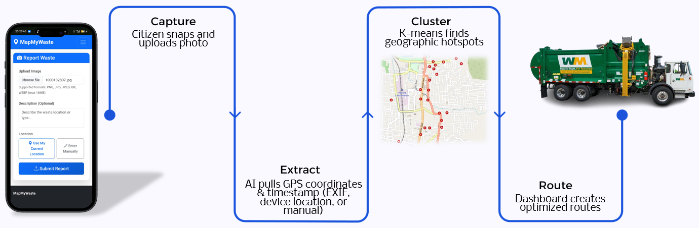
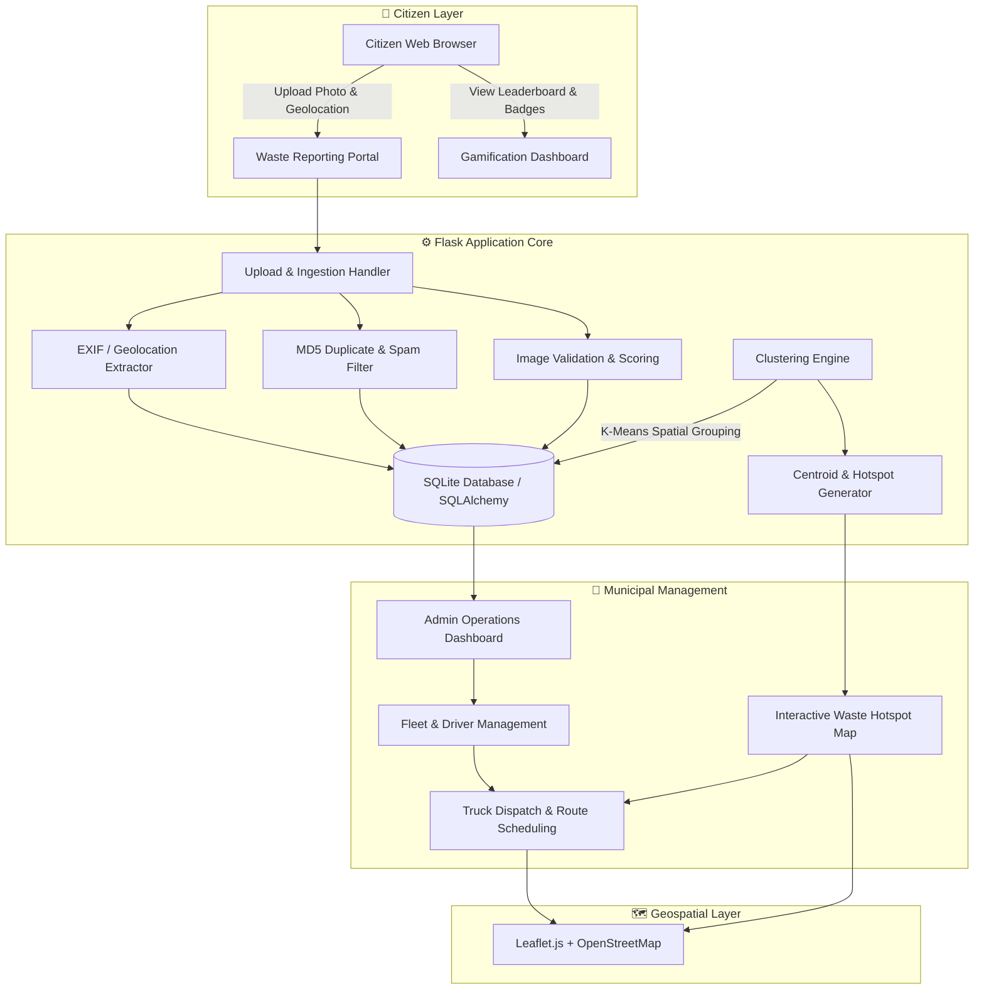
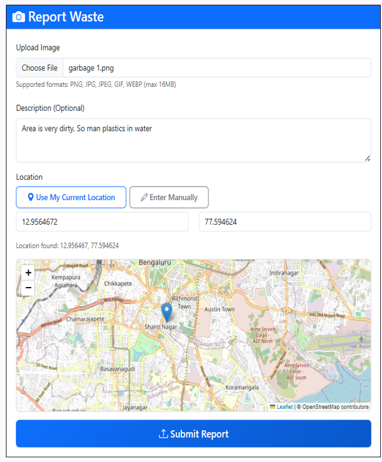
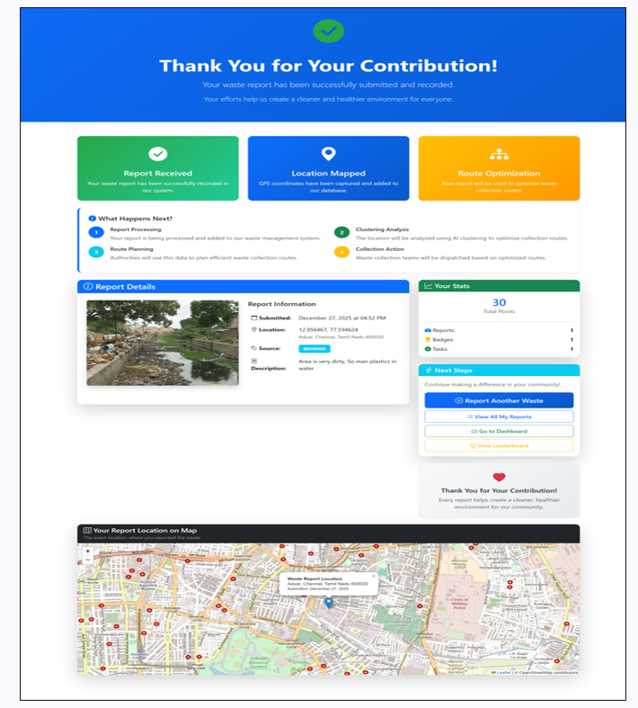
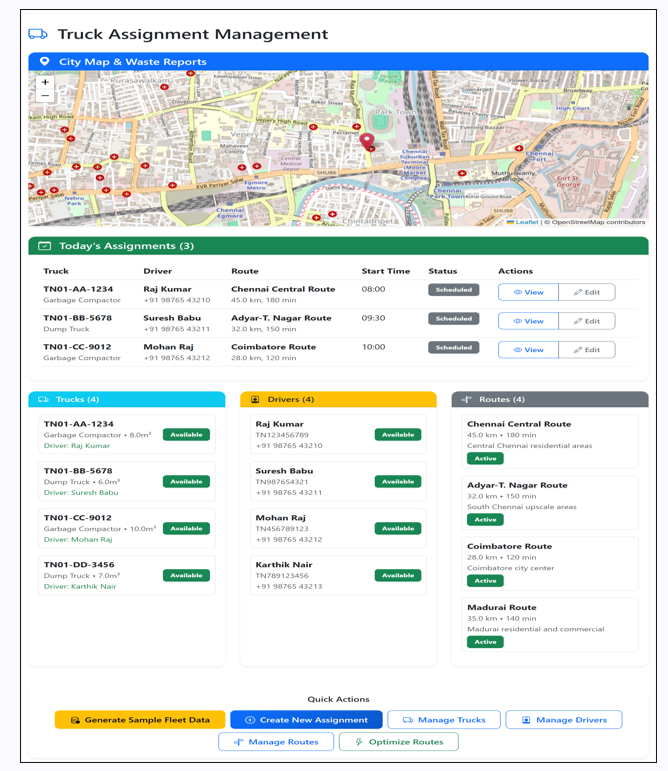

# CiviClean

### Cleaner Cities. Smarter Communities.

[](https://www.python.org/)
[](https://flask.palletsprojects.com/)
[](https://www.sqlite.org/)
[](https://www.sqlalchemy.org/)
[](https://scikit-learn.org/)
[](https://leafletjs.com/)
[](https://getbootstrap.com/)

**CiviClean** is an open-source civic technology platform designed to transform community waste reporting into data-driven municipal collection planning. By combining citizen-contributed photo reports with geographic metadata extraction, spatial K-Means clustering, and municipal fleet dispatch workflows, CiviClean bridges the gap between public cleanliness monitoring and municipal sanitation logistics.

---

## 📌 Workflow Overview



CiviClean coordinates a structured 4-step pipeline:
1. **Capture**: Citizens capture and submit geo-located photos of waste accumulation in their neighborhoods.
2. **Extract**: The platform automatically extracts GPS coordinates via EXIF metadata, browser geolocation, or manual map selection.
3. **Cluster**: Spatial clustering algorithms aggregate scattered reports into prioritized waste collection zones and identify optimal service centroids.
4. **Route & Dispatch**: Municipal administrators monitor hotspots, schedule sanitation trucks, and assign collection routes to drivers.

---

## 🛑 Problem Statement

Rapid urban growth and distributed populations present substantial challenges for municipal sanitation authorities:

- **Unreported Waste Accumulation**: Illegal dumping sites and overflowing bins often go unnoticed until they become public health hazards.
- **Unstructured Citizen Reporting**: Traditional complaint mechanisms (calls, emails, social media) lack verified location data, precise coordinates, and visual evidence, delaying municipal response.
- **Static Collection Schedules**: Collection trucks frequently follow fixed, predefined routes regardless of where waste has actually accumulated, resulting in excessive fuel consumption and unserviced hotspots.
- **Lack of Civic Feedback**: Citizens rarely receive confirmation or visibility into the resolution of reported issues, leading to community disengagement.

---

## 💡 Solution Architecture

CiviClean addresses these challenges through a unified web platform that integrates civic reporting with administrative logistics:



---

## ✨ Features

### 👥 Citizen Experience
- **Account Management & Authentication**: Secure sign-up, sign-in, and session persistence powered by Flask-Login and Werkzeug password hashing.
- **Multi-Source Geolocation Capture**:
  - **EXIF GPS Metadata Extraction**: Automatically parses embedded GPS tags (`GPSLatitude`, `GPSLongitude`) directly from photo files using Pillow.
  - **Browser Geolocation API**: Allows citizens to submit their real-time device location with one click.
  - **Interactive Map Picker / Manual Input**: Fallback interface enabling users to specify exact geographic coordinates.
- **Automated Duplicate Prevention**: Computes cryptographic MD5 hashes of uploaded images to flag duplicate or spam submissions.
- **Personal Dashboard & Report History**: Tracks all submitted reports, verification status, timestamps, and geographic coordinates.
- **Civic Gamification & Achievements**:
  - Points awarded for verified reports (10 base points + milestone bonuses).
  - Progressive achievement badges: *Rookie Reporter* (1 report), *Neighborhood Watcher* (5 reports), and *Waste Warrior* (20 reports).
  - City-wide public leaderboard fostering community engagement.

### 🧠 Waste Intelligence & Spatial Analytics
- **Spatial K-Means Hotspot Clustering**: Analyzes coordinate distributions using `scikit-learn` to automatically group scattered reports into distinct collection zones.
- **Centroid Calculation**: Computes mathematical centroids for each cluster to identify optimal pickup points for municipal fleets.
- **Interactive Geospatial Visualization**: Interactive Leaflet.js map with OpenStreetMap tiles displaying individual waste reports, severity markers, and cluster centroid overlays.
- **Image Content Verification**: Image integrity verification via Pillow with integrated scoring heuristics.

### 🚛 Municipal Operations & Fleet Management
- **Administrative Command Center**: Centralized overview displaying total reports, registered users, active clusters, and recent incident logs with sorting by recency or waste score.
- **Fleet Asset Registry**: Full CRUD management of municipal trucks, including capacity ($m^3$), vehicle type (Compactor, Dump Truck), and assigned driver.
- **Driver Roster**: Profile tracking for sanitation personnel, license verification numbers, contact information, and duty availability status.
- **Route Management**: Define collection routes with distance metrics, estimated completion durations, and JSON-encoded waypoint stops.
- **Daily Dispatch Assignments**: Schedule and assign specific trucks, drivers, and routes for targeted collection dates with operational status tracking (*Scheduled*, *In-Progress*, *Completed*).
- **Prototyping & Demo Seeders**: Built-in administrative tools to generate realistic sample reports, users, and fleet records for operational simulation.

---

## 📸 Interface Showcase

| Citizen Waste Reporting Interface | Submission Result & Gamification |
| :---: | :---: |
|  |  |
| *Citizens upload waste evidence with automatic GPS coordinate extraction and interactive Leaflet map preview.* | *Submission receipt displaying location geocoding, points awarded, badge unlock notifications, and next steps.* |

<br>

| Municipal Fleet Dispatch & Route Planning |
| :---: |
|  |
| *Administrative dashboard combining city-wide hotspot mapping, truck schedules, driver rosters, and daily dispatch assignments.* |

---

## 🛠️ Technology Stack

| Layer | Technology | Version | Purpose |
| :--- | :--- | :--- | :--- |
| **Backend Framework** | [Flask](https://flask.palletsprojects.com/) | `2.3.3` | Core web framework, application factory, and routing blueprints |
| **Database & ORM** | [SQLite 3](https://sqlite.org/) / [SQLAlchemy](https://www.sqlalchemy.org/) | `3.0.5` / `2.0+` | Relational data persistence, schema migrations, and ORM abstractions |
| **Authentication** | [Flask-Login](https://flask-login.readthedocs.io/) / [Werkzeug](https://palletsprojects.com/p/werkzeug/) | `0.6.3` / `2.3.7` | User session management, access control, and password hashing |
| **Spatial Clustering** | [scikit-learn](https://scikit-learn.org/) | `1.3.2` | K-Means clustering algorithm for grouping geographic waste coordinates |
| **Scientific Computing** | [NumPy](https://numpy.org/) | `1.26.4` | Matrix computations and coordinate transformations for clustering |
| **Image Processing** | [Pillow (PIL)](https://python-pillow.org/) | `10.1.0` | Image file validation, format conversions, and EXIF GPS metadata extraction |
| **Mapping & Geospatial** | [Leaflet.js](https://leafletjs.com/) | `1.9.4` | Client-side interactive maps, marker overlays, and coordinate previews |
| **Map Tile Provider** | [OpenStreetMap](https://www.openstreetmap.org/) | — | Open-source map tile layers |
| **Frontend Styling** | [Bootstrap](https://getbootstrap.com/) / Vanilla CSS | `5.3.0` | Responsive layout, modern UI components, and custom stylesheet |
| **Icons** | [Bootstrap Icons](https://icons.getbootstrap.com/) | `1.10.0` | Vector UI icons |

---

## 📐 Project Structure

```text
CiviClean/
├── app/
│   ├── __init__.py              # Application factory, extensions, and blueprint registration
│   ├── models.py                # SQLAlchemy models (User, WasteReport, Truck, Driver, Route, Assignment)
│   ├── admin/
│   │   ├── __init__.py          # Admin blueprint definition
│   │   └── routes.py            # Admin dashboard, clustering, map view, fleet & route management
│   ├── auth/
│   │   ├── __init__.py          # Auth blueprint definition
│   │   └── routes.py            # User registration, login, and session termination
│   ├── main/
│   │   ├── __init__.py          # Main blueprint definition
│   │   └── routes.py            # Landing page, waste upload flow, dashboards, profile, and leaderboard
│   ├── services/
│   │   ├── clustering.py        # Scikit-learn K-Means clustering implementation & centroid calculation
│   │   ├── detector.py          # Image verification, MD5 hashing, and waste detection scoring
│   │   ├── exif_utils.py        # EXIF GPS metadata extraction from uploaded photographs
│   │   ├── gamification.py      # Milestone calculations, badge awards, and points logic
│   │   └── sample_data.py       # Realistic demo data generator for users, reports, and fleet assets
│   ├── static/
│   │   ├── css/
│   │   │   └── style.css        # Custom UI styling and component rules
│   │   └── js/
│   │       └── main.js          # Client-side UI interactions
│   └── templates/
│       ├── admin/               # Administrative templates (dashboard, map, fleet, assignments)
│       ├── auth/                # Authentication views (login, register)
│       ├── main/                # Citizen views (index, upload, dashboard, report result, leaderboard)
│       └── base.html            # Master layout with navigation bar, alerts, and CDN assets
├── docs/
│   └── screenshots/             # Verified application interface screenshots
├── images/                      # Static branding and architecture diagrams
├── instance/                    # SQLite database storage directory (git-ignored)
├── model/                       # Pre-trained detector weights artifact (mapmywaste_garbage_detector.pth)
├── scripts/                     # Database maintenance and schema verification scripts
├── testing_files/               # Integration tests, diagnostic scripts, and project reference notes
├── uploads/                     # Storage directory for user-submitted waste photos
├── .env.example                 # Configuration template with environment variables
├── .gitignore                   # Version control ignore rules
├── config.py                    # Central application configuration class
├── requirements.txt             # Locked Python package dependencies
└── run.py                       # Local application entrypoint & default admin initialization
```

---

## 🚀 Installation & Local Setup

### Prerequisites
- **Python**: Version `3.10` or newer recommended.
- **Git**: Installed and configured on your system.
- **Web Browser**: Any modern browser (Chrome, Edge, Firefox, Safari).

---

### Step 1: Clone the Repository
```bash
git clone https://github.com/meliorism01/CiviClean.git
cd CiviClean
```

---

### Step 2: Set Up Virtual Environment

#### On Windows (PowerShell):
```powershell
python -m venv .venv
.\.venv\Scripts\Activate.ps1
```

#### On macOS / Linux:
```bash
python3 -m venv .venv
source .venv/bin/activate
```

---

### Step 3: Install Dependencies
```bash
pip install -r requirements.txt
```

---

### Step 4: Configure Environment Variables
Copy the `.env.example` template to `.env` (optional for local development, recommended for production):
```bash
# On Windows PowerShell
Copy-Item .env.example .env

# On macOS / Linux
cp .env.example .env
```

---

### Step 5: Run the Application
Launch the Flask development server:
```bash
python run.py
```

When started, `run.py` initializes the SQLite database schema automatically and seeds a default administrative account if one does not already exist.

```text
 * Serving Flask app 'app'
 * Debug mode: on
 * Running on http://127.0.0.1:5000
Admin user created: admin@mapmywaste.com / admin123
```

---

### Step 6: Access the Application
Open your browser and navigate to:
```text
http://127.0.0.1:5000
```

#### Default Development Credentials
| Role | Email | Password | Access Level |
| :--- | :--- | :--- | :--- |
| **Administrator** | `admin@mapmywaste.com` | `admin123` | Full access (`/admin/*`, fleet, clustering, map) |
| **Citizen User** | Self-registered via `/auth/register` | User-defined | Reporting portal (`/upload`, `/dashboard`, `/profile`) |

> [!WARNING]
> The default admin credentials are intended strictly for local development and demonstration. Change these credentials before deploying to any public or staging environment.

---

## 🧭 Application Routes & Endpoints

| Endpoint | Method | Access | Description |
| :--- | :---: | :---: | :--- |
| `/` | `GET` | Public | Landing page or automatic role-based redirect for authenticated users |
| `/auth/register` | `GET, POST` | Public | Citizen account registration |
| `/auth/login` | `GET, POST` | Public | User authentication and session creation |
| `/auth/logout` | `GET` | Authenticated | Terminates active user session |
| `/dashboard` | `GET` | Citizen | User personal overview, recent reports, and earned badges |
| `/upload` | `GET, POST` | Citizen | Waste reporting form with image upload and geolocation extraction |
| `/report/<id>/result` | `GET` | Citizen | Post-submission receipt with location geocoding and points feedback |
| `/reports/my` | `GET` | Citizen | Complete submission history for current citizen |
| `/profile` | `GET` | Citizen | User profile details and activity statistics |
| `/leaderboard` | `GET` | Public | Community points and reporting leaderboard |
| `/contact` | `GET, POST` | Public | Contact inquiry form |
| `/admin/` | `GET` | Administrator | Admin command dashboard with metric counters and report logs |
| `/admin/cluster` | `POST` | Administrator | Triggers K-Means spatial clustering across active waste reports |
| `/admin/map` | `GET` | Administrator | Geospatial map visualizer with reports and cluster centroids |
| `/admin/api/reports` | `GET` | Administrator | JSON API providing report locations and metadata for map rendering |
| `/admin/optimize-routes` | `GET, POST` | Administrator | Route optimization interface based on cluster centroids |
| `/admin/truck-assignments` | `GET` | Administrator | Fleet operations overview, map view, and daily assignment board |
| `/admin/manage-trucks` | `GET, POST` | Administrator | Vehicle registry management (truck number, capacity, type) |
| `/admin/manage-drivers` | `GET, POST` | Administrator | Driver registry management (license, phone, duty status) |
| `/admin/manage-routes` | `GET, POST` | Administrator | Collection route configuration and waypoint coordinates |
| `/admin/seed-data` | `POST` | Administrator | Seeds simulated citizen users and waste reports for testing |
| `/admin/seed-fleet-data` | `POST` | Administrator | Seeds sample trucks, drivers, routes, and daily schedules |
| `/admin/clear-recent-reports`| `POST` | Administrator | Cleans up reports created within the preceding 24 hours |
| `/admin/clear_reports` | `POST` | Administrator | Resets report database and clears non-admin demonstration data |

---

## ⚙️ Configuration & Security

All runtime settings are encapsulated in [config.py](config.py) and can be overridden via system environment variables:

| Variable | Default Value | Description |
| :--- | :--- | :--- |
| `SECRET_KEY` | `dev-secret-key-change-in-production` | Session encryption and CSRF security key |
| `DATABASE_URL` | `sqlite:///mapmywaste.db` | SQLAlchemy database connection URI |
| `UPLOAD_FOLDER` | `uploads` | Local directory for storing user-submitted images |
| `MAX_CONTENT_LENGTH` | `16777216` (16 MB) | Maximum permitted upload file size |
| `ALLOWED_EXTENSIONS`| `png, jpg, jpeg, gif, webp` | Whitelisted image file extensions |
| `DEFAULT_CLUSTERS` | `5` | Default number of K-Means clusters |
| `MIN_REPORTS_PER_CLUSTER` | `10` | Heuristic threshold to calculate dynamic cluster counts ($k$) |
| `POINTS_PER_REPORT` | `10` | Base points awarded per verified report |
| `DEPOT_LAT`, `DEPOT_LON`| `13.0827, 80.2707` | Central municipal depot coordinates for route planning |

### Security Measures Implemented
- **Password Hashing**: Passwords are cryptographically salted and hashed using Werkzeug (`scrypt` / `pbkdf2:sha256`).
- **File Upload Protection**: Validates extensions against an explicit whitelist and sanitizes filenames using `secure_filename()` with unique timestamps.
- **Request Size Limits**: Enforces a strict 16MB file limit at the application layer to guard against denial-of-service via oversized payloads.
- **Role-Based Access Control**: Sensitive administrative endpoints are guarded by the custom `@admin_required` decorator.
- **Repository Hygiene**: Sensitive database files (`*.db`, `*.sqlite`), user uploads, local virtual environments, and `.env` files are excluded via `.gitignore`.

---

## 🔬 Machine Learning & Algorithmic Implementation

### 1. Spatial K-Means Clustering (`app/services/clustering.py`)
To prevent erratic sanitation truck routing, CiviClean aggregates point reports into unified geographic zones using **K-Means clustering**:
- **Coordinate Matrix**: Extracts all valid $[latitude, longitude]$ pairs from active `WasteReport` records.
- **Dynamic Cluster Estimation**: If the number of clusters $k$ is not explicitly specified by the administrator, $k$ is calculated adaptively:
  $$k = \min\left(\text{DEFAULT\_CLUSTERS}, \max\left(1, \frac{N_{\text{reports}}}{\text{MIN\_REPORTS\_PER\_CLUSTER}}\right)\right)$$
- **Model Fitting**: Uses `sklearn.cluster.KMeans(n_clusters=k, random_state=42, n_init=10)` to compute cluster assignments.
- **Centroid Calculation**: Calculates geographic mean centers $(\bar{\phi}, \bar{\lambda})$ for each cluster group to represent optimal pickup depot stops:
  $$\bar{\phi} = \frac{1}{|C_i|} \sum_{r \in C_i} \phi_r, \quad \bar{\lambda} = \frac{1}{|C_i|} \sum_{r \in C_i} \lambda_r$$
- **Database Synchronization**: Updates the `cluster_id` foreign reference on each report and returns computed centroids for map rendering.

### 2. Cryptographic Duplicate & Spam Detection (`app/services/detector.py`)
To prevent redundant reporting and intentional spam:
- Computes an **MD5 cryptographic checksum** across binary chunks of each uploaded image.
- Queries existing records in `WasteReport` by `image_hash`. If an identical hash is found, the submission is flagged with `is_spam = True`.
- Additionally performs duplicate checking against normalized original filenames.

### 3. Waste Detection Scoring Architecture
- **Model Artifact**: A PyTorch weight checkpoint (`mapmywaste_garbage_detector.pth`) is located in the `model/` directory.
- **Inference Pipeline Status**: The production service currently verifies image integrity through Pillow (`img.verify()`) and generates a confidence score between 55% and 87% (`random.uniform(55, 87)`) for demonstration and validation. A local grayscale edge/texture variance heuristic function (`_heuristic_score`) is also included in `app/services/detector.py` as an algorithmic baseline.

---

## 🧪 Testing & Verification

The codebase includes utility scripts and integration tests located in `scripts/` and `testing_files/`:

### Database Schema Verification
Verifies table structure and required columns across all entities:
```bash
python -m scripts.print_db_location
```

### Integration Test
Validates image processing, hash calculation, waste report generation, and duplicate detection:
```bash
python -m testing_files.test_integration
```

> [!NOTE]
> When executing scripts within `testing_files/` or `scripts/`, run them as modules (`python -m <directory>.<script_name>`) from the repository root to ensure the application package (`app`) resolves correctly in your Python path.

---

## 🔮 Limitations & Future Roadmap

While CiviClean provides a robust operational foundation, several enhancements are planned for future releases:

1. **Production Deep Learning Inference**: Containerize a PyTorch/ONNX computer vision model (e.g., YOLOv8 or EfficientNet) to classify specific waste categories (organic, plastic, electronic, hazardous) directly on ingest.
2. **Dynamic Turn-by-Turn Routing**: Integrate an open-source routing engine (such as [OSRM](http://project-osrm.org/) or GraphHopper) to compute road-network-constrained paths between collection centroids, replacing straight-line centroid approximations.
3. **Real-Time Fleet Telematics**: Connect IoT GPS tracking units on municipal vehicles to stream live truck locations to the administrative map via WebSockets.
4. **Mobile Progressive Web App (PWA)**: Add service worker caching and offline photo queueing so citizens can document waste in areas with limited cellular connectivity.
5. **Municipal Work Order Integrations**: Enable automated export of scheduled assignments to municipal enterprise systems via RESTful webhooks.

---

## 🤝 Contributing & License

Contributions to improve CiviClean are welcome:
1. Fork the repository.
2. Create a feature branch: `git checkout -b feature/your-feature-name`.
3. Commit your changes with clear, descriptive commit messages: `git commit -m "feat: add your feature description"`.
4. Push to your branch: `git push origin feature/your-feature-name`.
5. Open a Pull Request detailing the problem solved and testing performed.

This project is licensed under standard open-source terms. See the repository for specific licensing details and third-party notices.

---

## 🌍 Our Mission

**CiviClean** is built on the belief that cleaner cities begin with informed, empowered communities. By transforming everyday citizens into active environmental contributors and equipping municipal authorities with spatial intelligence, CiviClean strives to make urban sanitation proactive, transparent, and efficient for all.
