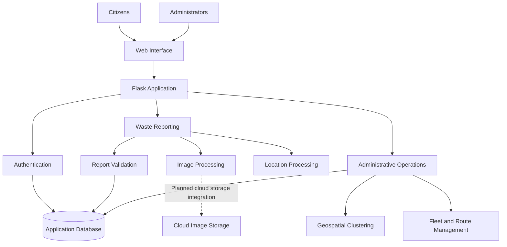
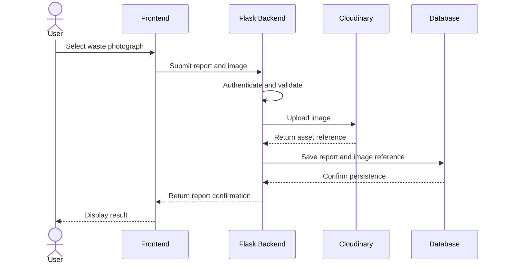

# ♻️ CiviClean: Crowdsourced Waste Tracking & Route Optimization

**Transforming citizen waste reports into AI-assisted collection planning for cleaner, smarter cities.**


---

## 📌 Overview

**CiviClean** is a smart waste reporting and collection management platform designed to connect community-driven waste reporting with data-informed collection planning.

The platform enables citizens to report garbage hotspots using photographs and location information. Administrators can review submitted reports, visualize waste locations, identify geographic clusters, and manage collection resources such as trucks, drivers, routes, and assignments.

By combining geospatial visualization, image processing, machine learning techniques, and gamification, CiviClean aims to make waste reporting more accessible and collection operations more organized.

## 🎯 Problem Statement

Improper waste disposal creates environmental, public health, and urban management challenges. Waste hotspots may remain unreported, while collection teams can struggle to prioritize locations and coordinate available resources efficiently.

Traditional reporting processes may lack centralized visibility, location-aware reporting, and convenient tools for identifying areas that require attention.

CiviClean addresses these challenges by providing a centralized platform for community reporting, geographic analysis, and waste collection management.

## 💡 Proposed Solution

CiviClean connects citizens and administrators through a unified waste management platform.

Citizens can submit waste reports with photographs and location information, track their submissions, and earn rewards for participating in community cleanliness initiatives.

Administrators can review reports, visualize waste hotspots on an interactive map, group nearby reports into geographic clusters, and manage fleet resources and collection assignments.

The platform is designed to support more informed collection planning through accessible reporting and location-based analysis.

## ✨ Key Features

### 📍 Location-Aware Waste Reporting

* Submit waste reports with photographs and descriptions.
* Support location input through browser geolocation, manual coordinates, or image GPS metadata where available.
* Associate reports with geographic locations.
* Display report confirmations and relevant report information.

### 🗺️ Interactive Waste Mapping

* Visualize reported waste locations on interactive maps.
* Use Leaflet.js and OpenStreetMap for geographic visualization.
* Help administrators identify areas with concentrated waste reports.
* Display cluster locations and geographic summaries where supported.

### 🧠 Geospatial Clustering

* Apply K-means clustering to group nearby waste reports.
* Identify geographic concentrations of reported waste.
* Support collection-zone planning using cluster information.

*Geographic clustering is distinct from vehicle-route optimization. Route efficiency depends on the routing algorithm, distance calculations, and operational constraints used.*

### 🏆 Gamification and Community Engagement

* Award points for eligible waste reports.
* Support badges and reporting statistics.
* Display leaderboards.
* Encourage continued participation in community cleanliness activities.

### 🛡️ Duplicate Report Detection

* Use image hashes and filename-based checks where implemented.
* Identify potential duplicate submissions.
* Provide duplicate-status information during the reporting workflow.

### 🚛 Fleet and Collection Management

* Manage truck records.
* Maintain driver information.
* Organize collection routes.
* Manage truck, driver, and route assignments.
* Support administrative collection planning.

### 📊 Administrative Dashboard

* Review submitted waste reports.
* Monitor user and reporting activity.
* Visualize geographic clusters.
* Review report scores and duplicate or spam indicators where available.
* Access fleet management and collection planning features.

### 🖼️ Image Upload and Processing

* Accept supported image uploads.
* Apply configured file validation.
* Use secure filename handling.
* Extract image metadata where supported.
* Process images through the configured detection or scoring service, if available.

---

## 🛠️ Technology Stack

| Layer                | Technology                        | Purpose                                          |
| -------------------- | --------------------------------- | ------------------------------------------------ |
| Programming Language | Python                            | Backend application logic                        |
| Web Framework        | Flask                             | Routing and server-side application              |
| Database             | SQLite                            | Persistent application data                      |
| ORM                  | SQLAlchemy                        | Database models and queries                      |
| Authentication       | Flask-Login                       | User session management                          |
| Password Security    | Werkzeug                          | Password hashing utilities                       |
| Frontend             | HTML, CSS, JavaScript             | User interface                                   |
| UI Framework         | Bootstrap 5                       | Responsive interface components                  |
| Mapping              | Leaflet.js                        | Interactive geographic maps                      |
| Map Data             | OpenStreetMap                     | Map visualization                                |
| Geospatial Analysis  | scikit-learn KMeans               | Geographic clustering                            |
| Numerical Processing | NumPy                             | Numerical operations                             |
| Image Processing     | Pillow                            | Image handling and metadata processing           |
| Image Storage        | Local storage currently described | Uploaded report images                           |
| Cloud Image Storage  | Cloudinary planned                | Potential centralized image storage and delivery |

The technologies listed above should be checked against the current dependency files and source code. Cloudinary should be considered a planned integration until its implementation has been verified.

---

## 🏗️ System Architecture

CiviClean follows a modular web application architecture centered on a Flask backend.

The application separates authentication, public-facing functionality, administrative operations, database models, and reusable services.

### High-Level Architecture



The cloud image storage component represents a potential future integration and should not be interpreted as an already implemented feature.

### Core Data Flow

1. A citizen opens the application and signs in.
2. The citizen submits a waste photograph with relevant report information.
3. The application validates the uploaded file.
4. The application obtains location information through supported input methods.
5. Image metadata and duplicate checks are processed where implemented.
6. The backend creates a waste report and associates it with the relevant user.
7. The application displays the report and its confirmation.
8. Eligible submissions may contribute to user points and badges.
9. Administrators review reports and visualize their geographic distribution.
10. Geographic clustering supports the identification of potential waste collection zones.
11. Administrators manage fleet resources and collection assignments.

The exact processing sequence depends on the current implementation.

---

## 📂 Project Structure

The following is a representative structure of the application. Verify it against the current repository before relying on it as an exact file inventory.

```text
CiviClean/
├── app/
│   ├── __init__.py
│   ├── models.py
│   ├── admin/
│   │   ├── __init__.py
│   │   └── routes.py
│   ├── auth/
│   │   ├── __init__.py
│   │   └── routes.py
│   ├── main/
│   │   ├── __init__.py
│   │   └── routes.py
│   ├── services/
│   │   ├── clustering.py
│   │   ├── detector.py
│   │   ├── exif_utils.py
│   │   ├── gamification.py
│   │   └── sample_data.py
│   ├── static/
│   │   ├── css/
│   │   └── js/
│   └── templates/
│       ├── admin/
│       ├── auth/
│       ├── main/
│       └── base.html
├── docs/
│   └── screenshots/
├── images/
├── instance/
├── model/
├── scripts/
├── testing_files/
├── uploads/
├── config.py
├── requirements.txt
├── run.py
├── .env.example
├── .gitignore
└── README.md
```

### Important Components

| Component                      | Responsibility                                        |
| ------------------------------ | ----------------------------------------------------- |
| `app/__init__.py`              | Application initialization and blueprint registration |
| `app/models.py`                | Database model definitions                            |
| `app/auth/`                    | Registration, login, and logout functionality         |
| `app/main/`                    | Public pages, dashboards, and reporting workflows     |
| `app/admin/`                   | Administrative pages and operational workflows        |
| `app/services/clustering.py`   | Geographic clustering logic                           |
| `app/services/detector.py`     | Image scoring and duplicate-detection utilities       |
| `app/services/exif_utils.py`   | Image metadata and GPS extraction                     |
| `app/services/gamification.py` | Points and badge-related logic                        |
| `app/services/sample_data.py`  | Demo data generation                                  |
| `config.py`                    | Application configuration                             |
| `requirements.txt`             | Python dependency definitions                         |
| `run.py`                       | Application startup entry point                       |
| `docs/screenshots/`            | Documentation screenshots                             |

Some directories may be generated locally or contain sensitive data. Local databases, uploaded user images, virtual environments, cache files, and secrets should be excluded from version control when appropriate.

---

## 📸 Application Screenshots

Add screenshots of the current CiviClean interface to the `docs/screenshots/` directory.

### Dashboard

Display the dashboard and its primary reporting or administrative information.


### Waste Report Submission

Show the form used to submit a waste report.


### Report Confirmation

Show the confirmation screen after a report is submitted.


### Collection Management

Show the interface for managing collection assignments and fleet resources.


### Workflow Overview

Show the system workflow or processing pipeline.


*Ensure that each referenced image exists at the specified path. Remove or replace any screenshot references that do not match the actual repository.*

---

## ⚡ Getting Started

### Prerequisites

* Python 3.10 or newer
* pip
* Git
* A modern web browser

### 1. Clone the Repository

```bash
git clone https://github.com/meliorism01/CiviClean.git
cd CiviClean
```

### 2. Create a Virtual Environment

```bash
python -m venv .venv
```

### 3. Activate the Environment

**Windows PowerShell**

```powershell
.\.venv\Scripts\Activate.ps1
```

**Windows Command Prompt**

```cmd
.venv\Scripts\activate.bat
```

**macOS/Linux**

```bash
source .venv/bin/activate
```

### 4. Install Dependencies

```bash
python -m pip install --upgrade pip
pip install -r requirements.txt
```

### 5. Configure Environment Variables

Review the application's configuration requirements before starting the server.

If the project uses `.env.example`, create a local `.env` file and populate the required values.

Never commit real credentials, API keys, or production secrets.

Ensure that `.env` is excluded by `.gitignore`.

### 6. Initialize the Database

Follow the database initialization procedure implemented by the application. If database tables are created automatically, verify that behavior in the startup code.

Do not assume that a production database can be initialized safely by running the development entry point.

### 7. Start the Application

```bash
python run.py
```

If the development server starts successfully, open:

```text
http://localhost:5000
```

The default port may differ depending on the application configuration.

---

## 👤 Citizen Workflow

1. Register an account or sign in.
2. Open the waste reporting interface.
3. Upload a photograph of the waste location.
4. Provide a description and location information.
5. Submit the report.
6. Review the report confirmation and available status information.
7. Track submitted reports through the dashboard or profile.
8. Earn points or badges when the applicable rules award them.

The exact workflow and available options depend on the implemented features.

## 🛡️ Administrator Workflow

1. Sign in using an authorized administrator account.
2. Review waste reports and recent activity.
3. Inspect report locations on the administrative map.
4. Run geographic clustering where supported.
5. Review potential waste hotspots.
6. Manage truck and driver information.
7. Maintain collection routes and assignments.
8. Review operational information to support collection planning.

Administrator access should be enforced by backend authorization checks.

**Security note:** No default administrator password is published in this documentation. Configure administrator access through a secure provisioning procedure.

---

## 📍 Routes and Endpoints

The following table represents routes described in the project documentation. Verify each endpoint, HTTP method, and access requirement against the current source code.

| Endpoint                   | Method                    | Description                            |
| -------------------------- | ------------------------- | -------------------------------------- |
| `/`                        | GET                       | Landing page or application redirect   |
| `/auth/register`           | GET, POST                 | User registration                      |
| `/auth/login`              | GET, POST                 | User login                             |
| `/auth/logout`             | GET, POST, as implemented | User logout                            |
| `/dashboard`               | GET                       | User dashboard                         |
| `/upload`                  | GET, POST                 | Waste report submission                |
| `/report/<id>/result`      | GET                       | Report result page                     |
| `/reports/my`              | GET                       | User report history                    |
| `/profile`                 | GET                       | User profile                           |
| `/leaderboard`             | GET                       | Leaderboard                            |
| `/contact`                 | GET, POST                 | Contact form                           |
| `/admin/`                  | GET                       | Administrative dashboard               |
| `/admin/cluster`           | POST                      | Geographic clustering operation        |
| `/admin/map`               | GET                       | Administrative map                     |
| `/admin/api/reports`       | GET                       | Report data for the administrative map |
| `/admin/optimize-routes`   | GET, POST                 | Route planning workflow                |
| `/admin/truck-assignments` | GET                       | Collection assignment dashboard        |
| `/admin/manage-trucks`     | GET, POST                 | Truck management                       |
| `/admin/manage-drivers`    | GET, POST                 | Driver management                      |
| `/admin/manage-routes`     | GET, POST                 | Route management                       |

These routes are a documentation starting point, not a guarantee that every endpoint is currently present or accessible.

Protected routes must verify authentication and authorization. State-changing operations should use appropriate HTTP methods and CSRF protection where applicable.

---

## 🗄️ Data Models

The documented application includes the following model categories. Confirm their actual fields and relationships in the database model definitions.

| Model            | Purpose                                                                 |
| ---------------- | ----------------------------------------------------------------------- |
| `User`           | User accounts, roles, and reporting-related information                 |
| `WasteReport`    | Waste report details, image references, location, and processing status |
| `ContactMessage` | Messages submitted through the contact form                             |
| `Driver`         | Driver records and availability information                             |
| `Truck`          | Collection vehicle information                                          |
| `Route`          | Collection route information                                            |
| `Assignment`     | Relationships between collection resources and scheduled work           |

### Database Considerations

* Define appropriate primary and foreign keys.
* Validate incoming data before database persistence.
* Apply access controls to user-specific records.
* Use migrations when changing the database schema.
* Avoid committing databases that contain private or production data.
* Document retention and deletion policies for reports and uploaded images.

---

## ⚙️ Configuration

The application configuration may include the following settings. Confirm the actual names and defaults in the current codebase.

| Setting                   | Purpose                                               |
| ------------------------- | ----------------------------------------------------- |
| `SECRET_KEY`              | Flask session security                                |
| `SQLALCHEMY_DATABASE_URI` | Database connection                                   |
| `UPLOAD_FOLDER`           | Local upload directory                                |
| `MAX_CONTENT_LENGTH`      | Maximum request size                                  |
| `ALLOWED_EXTENSIONS`      | Supported file extensions                             |
| `DEFAULT_CLUSTERS`        | Default clustering parameter                          |
| `MIN_REPORTS_PER_CLUSTER` | Minimum report count used in clustering configuration |
| `POINTS_PER_REPORT`       | Points awarded under the gamification rules           |
| `DEPOT_LAT`               | Collection depot latitude                             |
| `DEPOT_LON`               | Collection depot longitude                            |

### Configuration Best Practices

* Store sensitive values in environment variables or a managed secret store.
* Use a strong, unpredictable secret key in production.
* Validate configuration at application startup.
* Avoid hard-coded administrator credentials.
* Keep development and production configuration separate.
* Never log API secrets or passwords.

---

## ☁️ Cloudinary Integration Roadmap

Cloudinary is a proposed option for centralized image storage and delivery.

**Status: Planned — implementation must be verified before this section is marked complete.**

### Why Cloudinary?

Cloudinary can provide:

* Centralized image storage.
* HTTPS image delivery.
* Image transformations and optimization.
* Asset management through unique public identifiers.
* Delivery infrastructure for application images.

### Proposed Upload Workflow



### Proposed Implementation Steps

1. Audit the existing upload and image-display workflows.
2. Add the Cloudinary Python SDK to the dependencies.
3. Configure credentials through environment variables.
4. Create a reusable image-upload service.
5. Validate images on the backend before uploading.
6. Store the Cloudinary asset reference with the waste report.
7. Update image-display logic to support cloud URLs.
8. Preserve access to legacy local images where necessary.
9. Add upload failure handling and orphaned-asset cleanup.
10. Test the integration before deploying it.

### Suggested Environment Variables

```dotenv
CLOUDINARY_CLOUD_NAME=your_cloud_name
CLOUDINARY_API_KEY=your_api_key
CLOUDINARY_API_SECRET=your_api_secret
```

These are placeholders. Replace them with actual values in your local environment only.

Never commit real credentials. Keep the API secret on the backend and do not expose it to browser code.

### Database Compatibility

Review the existing `WasteReport` model before introducing additional fields.

Possible fields include:

* `image_url`
* `cloudinary_public_id`
* `image_storage_provider`

These are proposed fields and must be adapted to the existing schema.

### Integration Acceptance Criteria

* Authorized users can upload valid images.
* Invalid files are rejected.
* Cloudinary assets are referenced correctly in the database.
* The application displays stored images correctly.
* Existing reports remain accessible.
* Failures are handled without leaving uncontrolled orphaned assets.
* Secrets are absent from source control.
* Relevant tests pass.

---

## 🔐 Security and Privacy

Security is important because CiviClean processes user accounts, uploaded photographs, location information, and administrative operations.

### Authentication and Authorization

* Hash passwords using a suitable password-hashing mechanism.
* Protect user sessions and sensitive application routes.
* Enforce administrative permissions on the backend.
* Prevent users from accessing or modifying reports they do not own unless explicitly authorized.
* Avoid publishing default credentials.

### File Upload Security

* Validate actual image content.
* Restrict supported formats and upload sizes.
* Use safe filenames and storage references.
* Handle malformed images and upload errors.
* Avoid exposing internal filesystem paths.

### Location Privacy

* Explain when location information is collected.
* Consider whether image GPS metadata should be retained.
* Avoid exposing precise user locations unnecessarily.
* Review photographs for potentially sensitive visual content.

### Secrets and Configuration

* Keep credentials outside the repository.
* Exclude `.env` and other secret-bearing files from Git.
* Use appropriate production secret management.
* Rotate credentials if they are exposed.

### Data Management

* Define data retention policies.
* Restrict access to private reports.
* Protect database backups.
* Review logging to avoid recording sensitive information unnecessarily.

---

## 🧪 Testing and Quality Assurance

Testing should cover the application's core workflows and security-sensitive behavior.

| Area                | Recommended tests                                           |
| ------------------- | ----------------------------------------------------------- |
| Authentication      | Registration, login, logout, session handling               |
| Authorization       | Access to protected user and administrator routes           |
| Waste Reporting     | Valid and invalid submissions                               |
| Image Upload        | File validation, size limits, malformed files               |
| Location            | Coordinate validation and optional EXIF extraction          |
| Database            | Persistence, relationships, and invalid records             |
| Duplicate Detection | Repeated files and duplicate-status behavior                |
| Clustering          | Valid coordinates, insufficient data, and invalid inputs    |
| Gamification        | Points and badge rules                                      |
| Fleet Management    | Truck, driver, route, and assignment workflows              |
| Cloudinary          | Upload, persistence, display, failure handling, and cleanup |
| Security            | Unauthorized access, secret exposure, and upload abuse      |

### Running Tests

Use the test commands supported by the current repository. If a test suite is available, document its setup and invocation here.

Do not mark features as tested until the corresponding tests have actually been executed.

---

## 🚀 Deployment Considerations

Before deploying CiviClean, verify the requirements for the selected hosting environment.

Recommended considerations include:

* Production-ready WSGI server.
* Secure environment configuration.
* Appropriate database configuration.
* HTTPS.
* Database backups and migration procedures.
* Secure image storage.
* Application logging and error monitoring.
* Dependency updates and vulnerability checks.
* Rate limiting and upload-abuse prevention.
* Monitoring of storage, bandwidth, and service costs.
* Recovery procedures for application and database failures.

A local development server should not be treated as a production deployment solution.

---

## 🗺️ Future Roadmap

Potential future improvements include:

### Phase 1 — Reliability and Security

* Review authentication and authorization.
* Strengthen upload validation.
* Improve environment configuration.
* Establish automated tests.

### Phase 2 — Cloud Image Storage

* Integrate Cloudinary or another appropriate storage provider.
* Preserve existing report-image associations.
* Implement upload error handling and asset cleanup.
* Verify image privacy and access policies.

### Phase 3 — Geospatial Improvements

* Improve waste hotspot visualization.
* Evaluate clustering quality.
* Introduce meaningful geographic performance metrics.

### Phase 4 — Collection Route Optimization

* Define route-planning objectives and constraints.
* Evaluate routing algorithms.
* Measure route quality against a documented baseline.
* Account for depot locations, travel distances, and fleet availability where applicable.

### Phase 5 — Analytics and Monitoring

* Improve operational reporting.
* Add performance monitoring.
* Track report-processing and collection workflow metrics.

These are roadmap ideas, not claims that the functionality is already implemented.

---

## 🤝 Contributing

Contributions that improve CiviClean's reliability, usability, security, and maintainability are welcome.

Before contributing:

1. Review the existing architecture.
2. Keep changes focused and maintainable.
3. Follow established coding conventions.
4. Test affected functionality.
5. Document configuration or database changes.
6. Avoid committing secrets, private data, or generated artifacts.

### Suggested Contribution Workflow

1. Create a feature branch.
2. Implement the change.
3. Run relevant tests.
4. Review the changes for security and regressions.
5. Submit a pull request with a clear description.

---

## 📄 License

Add the applicable license information for this repository.

Do not claim a specific license until the repository's license file and applicable rights have been verified.

---

## 🌱 Project Vision

CiviClean aims to make community waste reporting more accessible and help collection teams make better-informed operational decisions.

By connecting citizens, geographic information, report analysis, and collection management, the platform seeks to support cleaner public spaces and more coordinated waste management.

**CiviClean — Report waste. Map hotspots. Plan smarter collections.**
